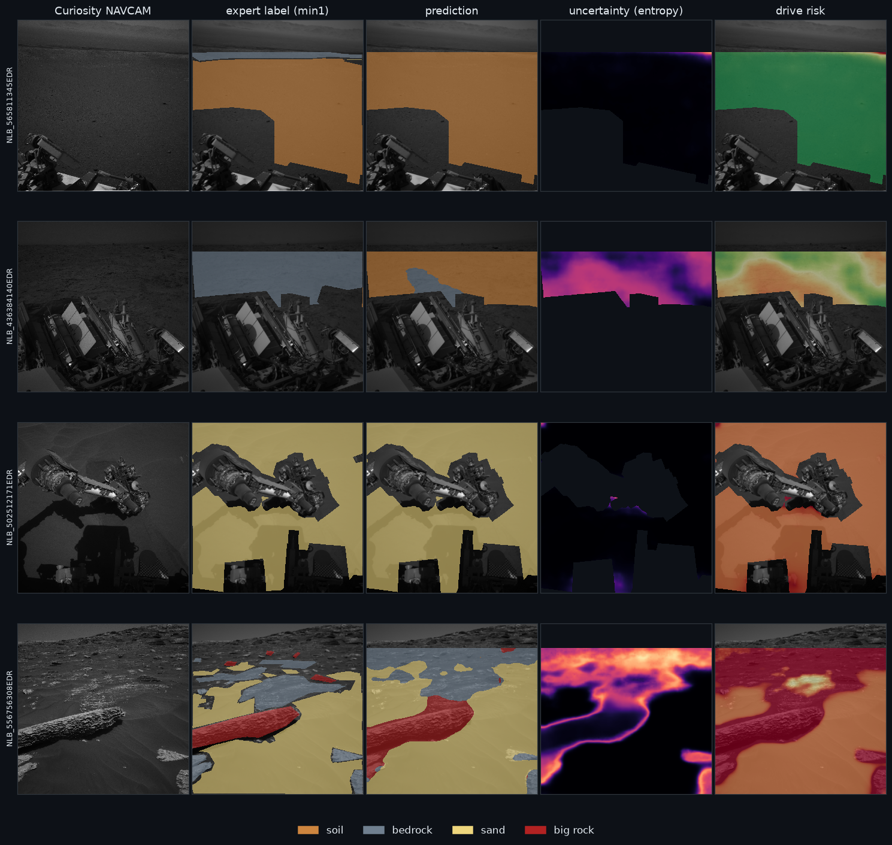
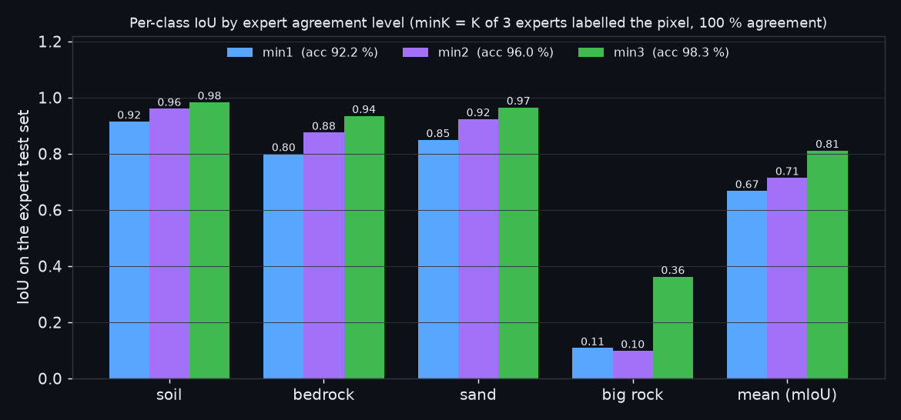
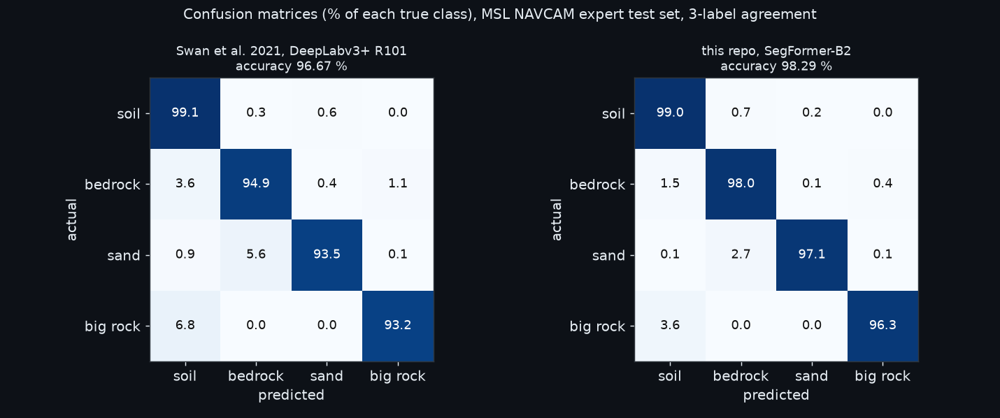
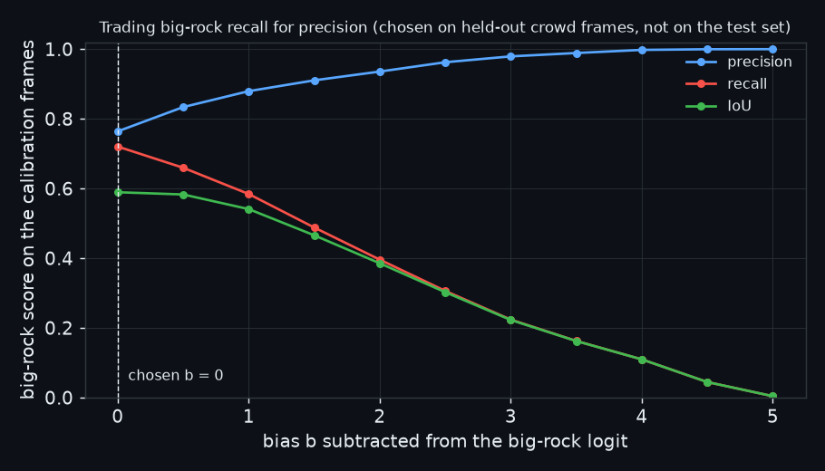
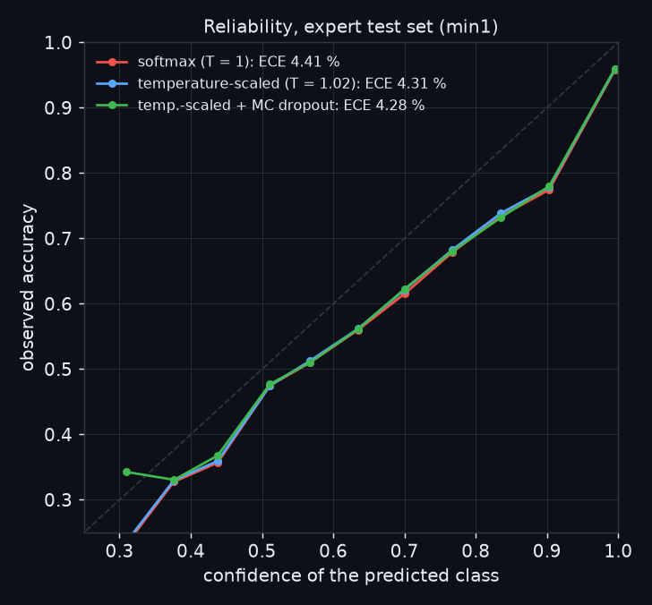
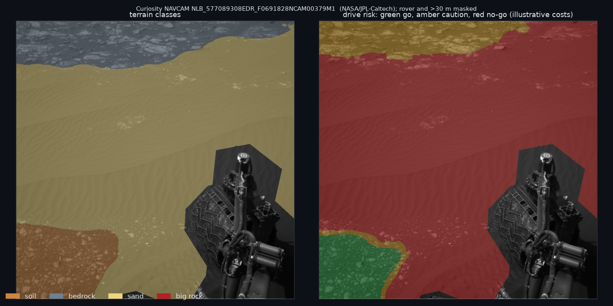
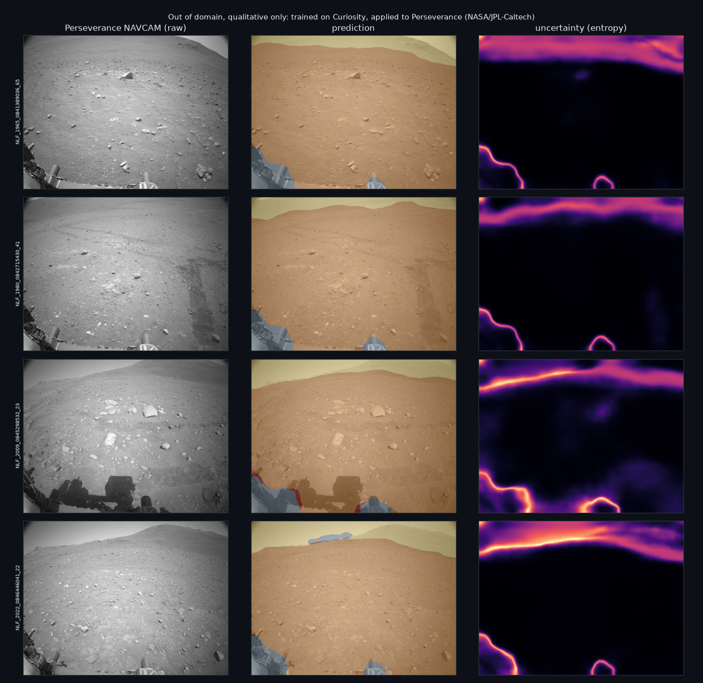
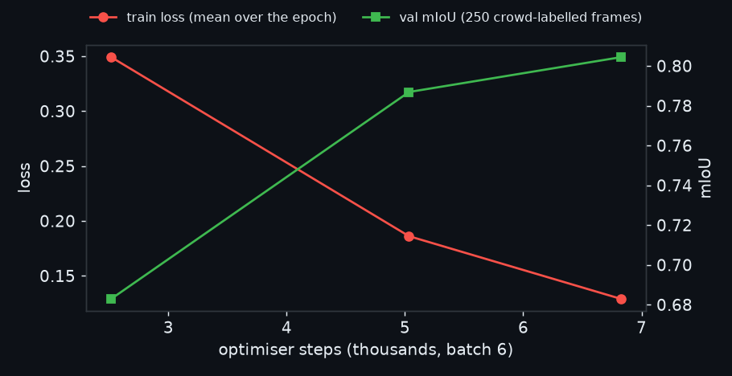

# mars-terrain-seg

**Terrain segmentation for Mars rover driving, trained on NASA JPL's AI4Mars dataset, with calibrated
uncertainty and a drive-risk map.**

A rover that knows *what* it is driving on (soil, bedrock, sand, big rocks) and *when it does not know*.
`marsseg` fine-tunes an ImageNet-pretrained SegFormer-B2 on 15,104 crowd-labelled Curiosity NAVCAM frames,
scores it on the expert-labelled test set of the AI4Mars paper, measures how honest its confidence is, and turns
class probabilities plus uncertainty into a go / caution / no-go overlay. It then drives, figuratively, into
Jezero crater: the same network on Perseverance images it never saw.

Built for the [Kister Space](https://www.youtube.com/@KisterSpace) channel, as a side project of its search for
planets around white dwarfs.



*Expert-labelled Curiosity test frames (NASA/JPL-Caltech). Columns: image, expert label, prediction, predictive
entropy, drive risk (green go, red no-go). Rover hardware and terrain beyond 30 m are masked.*

## Results in one paragraph

On the expert test set at the strictest agreement level (`min3`), pixel accuracy is **98.29 %** against
**96.67 %** for the DeepLabv3+ baseline of the AI4Mars paper, and the per-class recall is higher for bedrock, sand
and big rock (soil is equal within 0.1 point). That is the good news. The rest is more interesting:
**big rocks are found but over-called** (recall 96 %, precision 37 %, IoU 0.36 at `min3`; IoU 0.11 at `min1`),
something the paper's row-normalised confusion matrix cannot show; the network is **well calibrated on Curiosity**
(ECE 4.3 % on the densest test set, temperature 1.02) **but confidently wrong on Perseverance** (ECE 21.9 %,
mIoU 0.39 against crowd labels), so its own uncertainty does *not* warn about the change of rover and crater;
and Monte-Carlo dropout on the classifier head adds almost nothing to either.

## Results

### Expert test set (Curiosity NAVCAM, 322 frames)

`minK`: pixels labelled by at least K of the 3 experts, all with the same class. Scores at native 1024 px resolution,
labelled pixels only, after temperature scaling (argmax unchanged).

| test set | labelled pixels | pixel acc. | IoU soil | IoU bedrock | IoU sand | IoU big rock | mIoU |
|---|---:|---:|---:|---:|---:|---:|---:|
| `min1` | 194.3 M | 92.21 % | 0.915 | 0.800 | 0.850 | 0.108 | 0.668 |
| `min2` | 163.4 M | 95.98 % | 0.961 | 0.876 | 0.924 | 0.099 | 0.715 |
| `min3` | 117.0 M | **98.29 %** | 0.983 | 0.935 | 0.965 | 0.362 | 0.812 |



### Against the AI4Mars baseline

Swan et al. (2021) give, for `min3`, a confusion matrix normalised by true class and the overall accuracy
(Table 4: DeepLabv3+ with a ResNet-101 backbone, trained on the merged MSL NAVCAM labels at 513 px). They do not give
test-set IoU; their only mIoU (0.74, Fig. 7) is on random *validation* sets of crowd labels, which is not our split.

| `min3`, % of true class correctly labelled | soil | bedrock | sand | big rock | accuracy |
|---|---:|---:|---:|---:|---:|
| Swan et al. 2021, Table 4 | 99.10 | 94.90 | 93.45 | 93.24 | 96.67 |
| this repo | 99.04 | 97.99 | 97.10 | 96.35 | **98.29** |



Caveats for this comparison: the paper used the 2020 release, we use v0.6 (322 expert frames against the 323
the paper lists); one training run, one seed; the backbone and resolution differ. Read it as "a modern encoder
reaches and passes the published baseline", not as a controlled ablation.

### The big-rock problem

Big rocks are 0.07–0.2 % of the labelled test pixels. The network finds them (recall 0.52 / 0.80 / 0.96 at
`min1/2/3`) but also paints big rock on pixels the experts called bedrock or soil, so precision is 0.12 / 0.10 / 0.37
and the IoU collapses. A row-normalised confusion matrix, like Table 4 of the paper, hides this completely: our
96.35 % big-rock recall looks like the best number in the table.

Is it a threshold problem? We subtracted a bias from the big-rock logit and chose it on 547 held-out
*crowd-labelled* frames (never the test set). On those frames big-rock precision and recall are already balanced
(0.76 and 0.72), IoU peaks at bias 0, and every bias trades recall for precision without raising IoU
(`marsseg rare-bias`, `figures/bigrock_bias.png`). So the network agrees with the crowd and disagrees with the
experts about what counts as a big rock. The paper itself notes that big rock and bedrock are the classes where
the experts agreed least with each other (its Fig. 6) and calls the definition inherently ambiguous; the expert test
set holds very few big-rock pixels on which all three agreed. This is a label-definition gap, and fixing it needs
height information from stereo (the paper's own suggestion), not a different threshold.



### Calibration and uncertainty

Expected calibration error of the predicted-class confidence, expert test set:

| | `min1` | `min2` | `min3` |
|---|---:|---:|---:|
| softmax | 4.41 % | 1.61 % | 0.62 % |
| temperature-scaled (T = 1.025, fitted on held-out crowd frames) | 4.31 % | 1.53 % | 0.59 % |
| + Monte-Carlo dropout (10 passes) | 4.28 % | 1.49 % | 0.57 % |



The fitted temperature is 1.025: in its own domain the network is almost calibrated, and the residual ECE comes from
mild overconfidence at intermediate confidences (0.5–0.9), which is where expert labels and crowd labels disagree.
One dropout layer in front of a 1×1 classifier is a weak Bayesian approximation: the MC-dropout entropy is almost the
softmax entropy. A deep ensemble is the obvious next step and was not run here.

### Drive risk



The most mixed expert test frame (bedrock, sand ripples, soil). The risk is the expected class cost plus the
entropy; the sand field becomes no-go, the bedrock caution, the soil patch go. The costs are illustrative
(`marsseg/hazard.py`), so the map shows the plumbing a planner would use, not a validated mobility model.

### Out of domain: Perseverance in Jezero crater

The network has only seen Curiosity's 1-megapixel greyscale NAVCAM in Gale crater. Perseverance's NAVCAM is a
20-megapixel colour camera with a wider field, in a different crater.

- **Quantitative, against crowd labels.** AI4Mars v0.6 includes Perseverance NAVCAM frames with merged crowd labels
  in the same four classes (ranked below the Curiosity labels in the dataset's own cleaning order). On every fourth
  of the 2,355 labelled frames (589 frames, 333 M labelled pixels, converted to grey): pixel accuracy **63.1 %**,
  mIoU **0.392** (soil 0.568, bedrock 0.311, sand 0.450, big rock 0.238), ECE **21.9 %**. Bedrock suffers most:
  42 % of it is called soil.
- **Qualitative, on new images.** Four of six recent full-frame NAVCAM images from NASA's raw-image feed
  (sols 1965–2022). The network calls almost all of it plain soil, and its entropy stays low except at the horizon and around the
  rover hardware, which has no mask here.



The lesson: an uncertainty estimate learned in one domain is not a domain-shift alarm. Calibration was 5× worse
on Perseverance while the uncertainty maps looked just as calm.

### Training



15,104 frames, batch 6, 6,824 steps (2.7 epochs; the schedule was fitted into a 75-minute budget after measuring
the step time while other jobs shared the GPU). Best validation mIoU on 250 held-out crowd-labelled frames: 0.804
(soil 0.910, bedrock 0.930, sand 0.847, big rock 0.530).

## Limitations

1. One model, one seed, 2.7 epochs, no hyper-parameter search. Longer training would probably move the numbers.
2. The baseline comparison mixes dataset versions (2020 release vs v0.6) and backbones; it is not an ablation.
3. Accuracy is dominated by large homogeneous soil and sand regions; mIoU is dominated by the big-rock IoU. Both
   are reported, together with precision and recall for big rock, because each alone misleads.
4. Monte-Carlo dropout here samples only the classifier head; it is not a substitute for an ensemble.
5. The risk map's costs are not fitted to slip or wheel-damage data.
6. The Perseverance labels are crowd labels without an expert test set, the frames were converted to grey, and the
   raw-feed images are compressed browse products.

## How it works

| step | what | where |
|---|---|---|
| data | AI4Mars v0.6, NASA JPL (Zenodo 15995036, linked from data.nasa.gov). The release is one 16.2 GB ZIP with four rovers; `marsseg download` reads its central directory with HTTP range requests and fetches only the Curiosity NAVCAM members (6.15 GB: 18,127 frames, rover masks, 30 m range masks, crowd and expert labels) and, with `--m2020`, the Perseverance NAVCAM frames with their crowd labels | `marsseg/download.py`, `remotezip.py` |
| split | the 16,064 crowd-labelled frames are sorted by spacecraft clock and cut into blocks of 20 consecutive frames; 5 % of the blocks are held out, so near-duplicate neighbours never straddle train and validation. Frames whose merged label is empty are dropped (15,104 train, 797 validation). The held-out part is split again: 250 frames choose the best epoch, the other 547 only fit the temperature | `data.split_train_val`, `train.splits` |
| test | the 322 expert-labelled frames (3 experts each; `minK` keeps pixels that K experts labelled with 100 % agreement). None of them is in the training list, and the nearest training frame is a median 24 h of spacecraft time away | `data.msl_samples` |
| model | SegFormer with a MiT-B2 encoder (24.7 M parameters, ImageNet weights via `segmentation_models_pytorch`); grey frames replicated to three channels; a 2-D dropout layer (p = 0.1) in front of the classifier | `model.py` |
| training | random-resized square crops (35–100 % of the frame) at 512 px, flips, brightness/contrast jitter; rover and > 30 m pixels ignored; class-weighted cross-entropy with weights 1 − class share, as in the paper; AdamW, 10× learning rate on the decoder, warm-up + cosine schedule fitted into a wall-clock budget; bf16 autocast | `train.py` |
| inference | whole 1024 px frame resized to 512, logits upsampled back and scored at full resolution | `evaluate.py` |
| calibration | expected calibration error (15 bins, Guo et al. 2017) of the predicted-class confidence; one temperature fitted by NLL on the calibration frames; Monte-Carlo dropout (10 passes of the head on shared features) for epistemic uncertainty (mutual information) | `evaluate.py`, `metrics.py` |
| drive risk | expected cost of the class mix (soil 0.10, bedrock 0.30, sand 0.75, big rock 1.00) plus the normalised entropy, thresholds 0.3 / 0.6. The costs are illustrative, ordered only by the hazards the AI4Mars paper names | `hazard.py` |

```bash
pip install -e .[plots,test]
export MARSSEG_DATA=/path/to/data          # default ~/.marsseg
marsseg download --m2020                    # ~7.3 GB from Zenodo, resumable
marsseg train --epochs 20 --batch 6 --budget-min 75 --out runs
marsseg evaluate runs/segformer-b2.pt --mc 10 --out results
marsseg rare-bias runs/segformer-b2.pt --results results   # big-rock logit bias, fitted on held-out frames
marsseg perseverance                        # six recent NAVCAM frames from NASA's raw-image feed
marsseg figures runs/segformer-b2.pt --results results --out figures
marsseg predict runs/segformer-b2.pt my_image.jpg --out predictions
pytest -q                                   # offline tests on synthetic data
```

The trained weights (~100 MB) are not in the repository; `train` reproduces them in about 1.5 h on one RTX 5070
(shared with other jobs).

## Provenance

- Images: NASA/JPL-Caltech (Curiosity and Perseverance NAVCAM). Labels: AI4Mars volunteers on Zooniverse and the
  MSL/MER expert labellers (Swan et al. 2021).
- Perseverance frames for the qualitative test come from the public raw-image feed of mars.nasa.gov
  (`marsseg perseverance` writes their sol, image ID, URL and date to `perseverance_meta.json`; the six used here are listed in `results/perseverance_meta.json`).
- Every number in this README comes from `results/segformer-b2_test.json`, `results/segformer-b2_training_log.json` or the
  paper as cited.

## References

- Swan, R. M., Atha, D., Leopold, H. A., Gildner, M., Oij, S., Chiu, C., Ono, M. 2021, *AI4MARS: A Dataset for
  Terrain-Aware Autonomous Driving on Mars*, CVPR Workshops (AI4Space).
- AI4Mars dataset v0.6, NASA JPL, https://zenodo.org/records/15995036 (`info.md`, `label_keys.json`).
- Xie, E. et al. 2021, *SegFormer: Simple and Efficient Design for Semantic Segmentation with Transformers*,
  NeurIPS.
- Guo, C., Pleiss, G., Sun, Y., Weinberger, K. Q. 2017, *On Calibration of Modern Neural Networks*, ICML.
- Gal, Y., Ghahramani, Z. 2016, *Dropout as a Bayesian Approximation*, ICML.
- JPL news release *NASA Trapped Mars Rover Finds Evidence of Subsurface Water* (2010) and JPL's Spirit mission
  page, for the Troy sand trap (see LEARNING.md).

## License

MIT for the code. The AI4Mars data and NASA images keep their own terms; they are downloaded, not redistributed.
